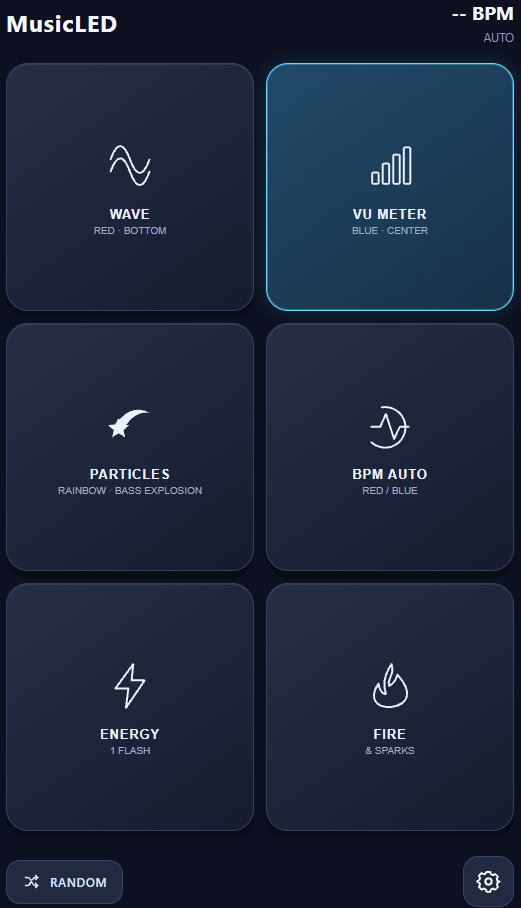
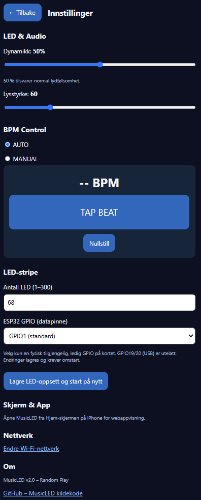

# MusicLED 🎵

**Music-reactive WS2812 LED strip controller for M5StickS3, with a mobile web interface.**

MusicLED uses the built-in microphone on the M5StickS3 to control an addressable LED strip. Select effects, change variants and choose color palettes from a phone on the same Wi-Fi network. No phone app or cloud service is required.

This README describes the current `master` branch. The mobile interface still contains some Norwegian labels; the documentation below uses English names and includes the relevant labels where useful.

## Features

- Six main effects with multiple animation variants.
- 48 selectable palettes, plus the original effect colors.
- Temporary global palettes, individual effect palettes and palette direction reversal.
- Automatic BPM detection, manual tempo and TAP BEAT.
- Random Play with timed switching during pauses in the music.
- Adjustable brightness and audio response.
- Configurable LED count and data GPIO.
- Wi-Fi setup access point, saved network credentials and local hostname.
- Mobile home-screen shortcut with a MusicLED icon.

## Screenshots

The following spaces are reserved for new screenshots of the current interface.

### Main screen

Six effect pads, animation variant labels, BPM status, palette access and Random Play.

> **Screenshot coming soon:** `docs/images/musicled-main.png`

<!-- After uploading the image, remove this comment wrapper:

-->

### Color palettes

Palette groups, the active selection, original colors and palette direction controls.

> **Screenshot coming soon:** `docs/images/musicled-palettes.png`

<!-- After uploading the image, remove this comment wrapper:

-->

### Settings

Audio response, brightness, automatic/manual BPM, TAP BEAT, LED configuration and network access.

> **Screenshot coming soon:** `docs/images/musicled-settings.png`

<!-- After uploading the image, remove this comment wrapper:

-->

### Hardware and LED effects

M5StickS3, the connected strip and an example of an effect in use.

> **Photo coming soon:** `docs/images/musicled-hardware.jpg`

<!-- After uploading the image, remove this comment wrapper:

-->

To add images later, upload them to [docs/images](docs/images) using the filenames above, then uncomment the matching `` line and remove its “coming soon” notice. Portrait screenshots are displayed at 320 pixels wide.

<details>
<summary>Earlier interface: v2.0 screenshots</summary>

These images show the earlier interface and do not include the current palette controls.

**Main screen**



**Settings**



</details>

## Effects

| Effect | Variants and behavior |
|---|---|
| **Wave** | Standard, Top, Bottom and Ping Pong. Moving wave variants respond to detected beats. |
| **VU Meter** | Normal or Center layout, with a peak marker. Center grows outward from the middle of the strip. |
| **Particles** | Bass Explosion, Diffusion, Breathe, Streamer, Bouncing Balls and Fireworks. |
| **BPM Auto** | Flash or Solid. Flash produces short beat pulses; Solid holds the color between beats while music is active. |
| **Energy Strobe** | Music-reactive bursts with 1, 2, 3 or 4 flashes. |
| **Fire & Sparks** | Standard flame or With Blink, which adds music-reactive sparkles. |

### Particle variants

- **Bass Explosion:** Pulses travel outward from the center.
- **Diffusion:** Light spreads outward from the center.
- **Breathe:** The strip brightness follows the music envelope.
- **Streamer:** Moving light trails.
- **Bouncing Balls:** Particles launch from LED 0 and bounce with gravity and varying heights.
- **Fireworks:** White rockets launch from LED 0 and burst into colored fragments, with varying launch heights and overlapping rockets.

## Mobile controls

| Action | Result |
|---|---|
| Tap an effect pad | Selects that effect and exits Random Play. |
| Tap the active effect pad again | Cycles its animation variant. No double tap is needed. |
| Tap the palette/paintbrush button | Opens the color palette screen for the selected effect. |
| Tap **RANDOM** | Starts Random Play and selects a random effect combination. |
| Tap **RANDOM** again | Immediately selects another random combination. |
| Tap the gear button | Opens settings. |
| Tap the back button (**Tilbake**) | Returns to the main screen. |

The active pad shows the selected animation variant. Use the palette screen to change colors separately from the animation.

## Color palettes

There are **48 palette choices**, arranged in five groups, plus a default option for the original effect colors.

| Group | Choices | Purpose |
|---|---:|---|
| Temporary / all effects | 8 | Rainbow, Party, Ocean, Forest, Midnight Petrol, Velvet Lounge, Teal / Coral and Cobalt / Copper. |
| Multicolor | 16 | Includes Sunset, Lava, Aurora, C9, Plum Night, Deep Brass, Fire Flames, Explode and several party palettes. |
| Four colors | 8 | Neon, Tropical, Icefire, Retro, Candy, Autumn, Night and Vintage. |
| Single color / shades | 8 | Red, Blue, Green, Purple, Amber, Cyan, Pink and White. |
| Two colors / 50–50 | 8 | Includes Red / Blue, Blue / Gold, Pink / Cyan and other paired colors. |

### How palette selection works

- **Outside Random Play:** The first eight palettes are temporary global overrides. Other palette choices are assigned to the currently selected effect.
- **Default:** Returns the selected effect to its original colors and clears the temporary global override.
- **Reverse:** Reverses the palette direction for the selected effect where the renderer uses a directional palette.
- **During Random Play:** Starting Random keeps the current palette. Any palette selected while Random is running applies across its effects. The BPM Flash/Solid choice is retained.
- **Appearance:** Effects use palettes differently: for example, some use a spatial gradient, while moving particles can keep a selected palette color throughout their lifetime. Screen previews and physical LED colors may differ.

## Random Play

Random Play selects effects and supported subvariants without immediately repeating the same combination.

An automatic change requires **both**:

1. At least **three minutes** with the current selection.
2. At least **three seconds without detected musical activity**, after activity has been detected.

Continuous music can therefore keep the same effect running for longer than three minutes. Press **RANDOM** again to switch immediately. Selecting an effect manually exits Random Play.

## Hardware

| Item | Details |
|---|---|
| Controller | **M5StickS3**, ESP32-S3, with built-in microphone and display. |
| LED strip | **5 V WS2812-compatible**, individually addressable LEDs. |
| Default LED count | **62**; configurable from **1 to 300**. |
| Default data output | **GPIO1**. |
| Default brightness | **150 / 255**. |
| Strip power | External regulated **5 V** supply sized for the connected strip. |

The hardware target is M5StickS3. The PlatformIO configuration uses the `esp32-s3-devkitc-1` board definition with project-specific memory and build settings.

### Wiring

| From | To |
|---|---|
| M5StickS3 GPIO1 | LED strip **DIN** |
| M5StickS3 GND | LED strip GND and power supply negative |
| External 5 V supply positive | LED strip +5 V |

Connect a common ground and use the strip's **DIN**, not DOUT. Power the strip from the external supply. A data-line series resistor, a capacitor at the strip power input and a suitable logic-level shifter can help provide a reliable installation.

Choose a physically available, unused pin if changing GPIO. GPIO19 and GPIO20 are excluded from the settings because they are used for USB on ESP32-S3.

## Getting started

1. Install **Visual Studio Code** and the **PlatformIO IDE** extension.
2. Clone this repository and open its project folder:

   ```bash
   git clone https://github.com/kagjerde/MusicLED-web-application-for-M5-Stick-to-control-disco-LED-strip.git
   cd MusicLED-web-application-for-M5-Stick-to-control-disco-LED-strip
   ```

3. Check [platformio.ini](platformio.ini). The upload and monitor ports are currently set to `COM5`; change them for your computer, or remove those settings to allow automatic port detection.
4. Build and upload using PlatformIO. The environment is `m5stack-sticks3`.
5. On first boot, connect your phone to **MusicLED-Setup**, password **MusicLED123**.
6. Open **http://192.168.4.1/** if the setup page does not open automatically.
7. Select your **2.4 GHz Wi-Fi network**, enter its password and save. The device restarts and remembers the credentials.
8. Reconnect your phone to the same network and open **http://musicled.local/**. If the hostname does not resolve, use the device IP printed in the serial monitor at **115200 baud**.

Optional PlatformIO CLI commands:

```bash
pio run -e m5stack-sticks3
pio run -e m5stack-sticks3 -t upload
pio device monitor -b 115200
```

On iPhone, open the main page in Safari and use **Share → Add to Home Screen** for a MusicLED shortcut with its own icon.

The setup password is defined as `SETUP_PASSWORD` in [src/main.cpp](src/main.cpp). Change it before sharing an installation. The web controls have no authentication and are intended for a trusted local network.

## Settings and diagnostics

| Setting | Function |
|---|---|
| Dynamics (**Dynamikk**) | Adjusts audio response from 0–100%; 50% is the normal baseline. |
| Brightness (**Lysstyrke**) | Adjusts LED brightness from 1–255. |
| BPM Auto / Manual | Uses the detected tempo or a manually tapped tempo. |
| **TAP BEAT** | Sets manual BPM by repeated taps. |
| Reset (**Nullstill**) | Clears the tap history. |
| LED count and GPIO | Saves strip configuration and restarts the device. |
| Network setup | Opens the Wi-Fi configuration page. |

The palette page also includes a live **HEX color test** for three strip zones. It temporarily overrides the music effects, allowing colors to be checked directly on the LEDs. Use the restore-music control to return to the normal effects.

### Physical buttons and device display

In the current `master` firmware:

- **Button A:** Cycles the six main effects.
- **Button B:** Cycles legacy colors in VU Meter and Particles, or the flash count in Energy Strobe.
- The built-in display shows effect information and visualizations. The phone provides the full palette and settings interface.

## Troubleshooting

- **No LED output:** Check the 5 V supply, common ground, selected GPIO, LED count and strip input direction.
- **Incorrect or unstable colors:** Check the data connection and power supply, and consider a logic-level shifter.
- **Cannot open musicled.local:** Use the IP address from the serial monitor and check that the phone is on the same local network.
- **An effect does not react as expected:** Check microphone placement, dynamics and the selected BPM mode. Automatic tempo detection depends on the music.
- **Strip remains static:** Check whether the HEX color test is active and restore music mode.
- **Random does not advance:** It waits for both the minimum duration and a pause in detected musical activity.

## Project structure

| Path | Contents |
|---|---|
| [src/main.cpp](src/main.cpp) | Audio analysis, LED effects, web interface, settings and Wi-Fi setup. |
| [platformio.ini](platformio.ini) | PlatformIO target, dependencies and build configuration. |
| [docs/images](docs/images) | Screenshots and documentation images. |

Built with **Arduino**, **M5Unified**, **Adafruit NeoPixel**, **arduinoFFT**, Wi-Fi, WebServer and mDNS.

MusicLED is a hobby project for music-reactive lighting.
