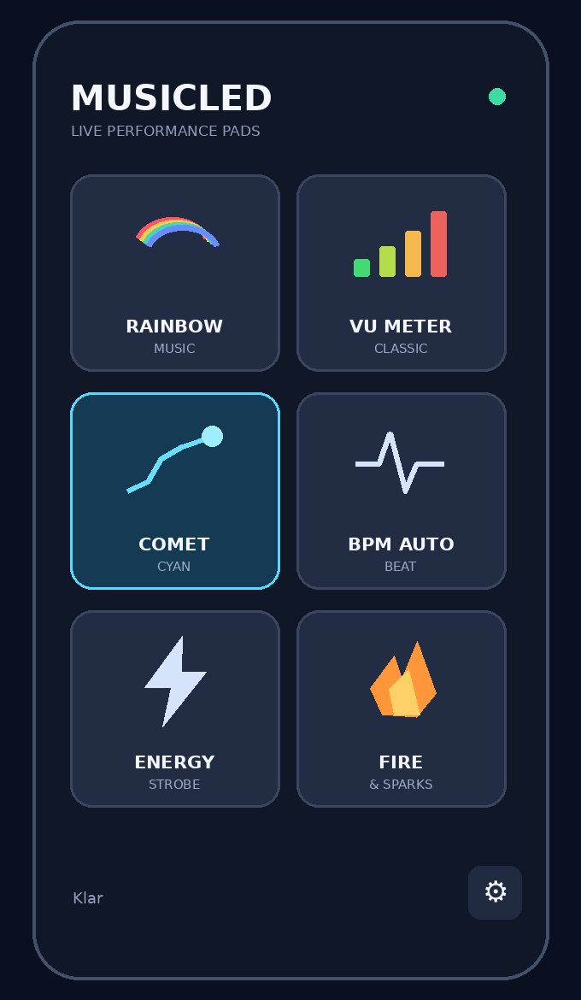

# MusicLED 🎵

**Musikkstyrt WS2812 LED-stripe med M5StickS3 og mobilvennlig webkontroll.**

MusicLED bruker mikrofonen i M5StickS3 til å styre en adresserbar LED-stripe. Effekter velges fra en telefon på samme Wi-Fi-nettverk.

**Stabil versjon: v2.0 – Random Play** (testet og godkjent på M5StickS3).



> Illustrasjonsbildene i dette repositoriet kan vise et eldre grensesnitt.

## Effekter

| Hovedmodus | Beskrivelse |
|---|---|
| **Wave** | Standard regnbueeffekt, Top, Bottom og Ping Pong. Løpelys kan starte på registrerte basslag. |
| **VU Meter** | Normal nivåmåler eller Center VU, som vokser fra midten mot endene. |
| **Particles** | Bass Explosion, Diffusion, Breathe, Streamer, Bouncing Balls og Fireworks. |
| **BPM Auto** | Lysblink som følger registrert eller manuelt tempo. |
| **Energy Strobe** | Musikksynkroniserte blink med valg av antall blink per slag. |
| **Fire & Sparks** | Flamme med musikkstyrte gnister. |

### Particles

- **Bass Explosion:** Lyspulser fra midten og ut til begge ender.
- **Diffusion:** Brede, myke fargefelt som sprer seg.
- **Breathe:** Hele stripen pulserer med musikken.
- **Streamer:** Bevegelige lysstrømmer.
- **Bouncing Balls:** Lysballer skytes opp fra LED 0 og spretter med gravitasjon og varierende høyde.
- **Fireworks:** Hvit rakett skytes opp fra LED 0 og eksploderer i fargede fragmenter, med varierende høyde og spredning.

**Betjening:** Trykk på en hovedknapp for å velge effekt. Enkelttrykk på aktiv knapp bytter farge eller effektens spesialvalg; dobbelttrykk på Wave, VU Meter og Particles bytter variant.

## Random Play (v2.0)

Den lille **RANDOM**-knappen nederst på hovedskjermen starter automatisk effektvalg.

- Første trykk aktiverer Random og velger en tilfeldig effekt, variant og farge.
- Neste trykk velger umiddelbart en ny kombinasjon.
- Automatisk bytte skjer **først etter minst tre minutter med gjeldende effekt OG minst tre sekunder sammenhengende stillhet**.
- Et manuelt valg av hovedmodus avslutter Random.
- Samme kombinasjon velges ikke to ganger etter hverandre.

## Maskinvare

- **M5StickS3** (ESP32-S3), med innebygd mikrofon og skjerm
- **WS2812-kompatibel LED-stripe**, standard 68 LED-er
- **Datapin:** GPIO1 som standard; LED-antall og GPIO kan konfigureres i innstillingene
- **Ekstern regulert 5 V strømforsyning** til LED-stripen

### Kobling

```text
M5StickS3 GPIO1  ─────────── DIN på WS2812
M5StickS3 GND    ─────┬───── GND på WS2812
                      │
5 V strømforsyning − ─┘
5 V strømforsyning + ─────── +5V på WS2812
```

**Viktig:** Bruk felles jord. Ikke forsyn hele LED-stripen fra M5StickS3. Kontroller at du bruker `DIN`, ikke `DOUT`. Seriemotstand på datalinjen og kondensator ved stripeinngangen anbefales; vurder nivåskifter dersom 3,3 V datasignal ikke er stabilt.

## Kom i gang

1. Installer **Visual Studio Code** med **PlatformIO**.
2. Åpne prosjektmappen og kontroller `platformio.ini`.
3. Bygg prosjektet (**Build**) og last det opp til M5StickS3 (**Upload**).
4. Ved første oppstart: koble telefonen til **MusicLED-Setup** med passord **MusicLED123**.
5. Åpne `http://192.168.4.1` og konfigurer Wi-Fi.
6. Åpne **http://musicled.local/** fra en enhet på samme nettverk. Dersom mDNS ikke fungerer, bruk enhetens IP-adresse.

> **Sikkerhet:** Endre standardpassordet for oppsett-AP før vanlig bruk. Webkontrollen er laget for et betrodd lokalnettverk, ikke direkte eksponering mot internett.

## Innstillinger

Innstillingssiden åpnes med tannhjulet. Den har blant annet lysstyrke, dynamikk/lydfølsomhet, LED-antall, GPIO og informasjon om prosjektet. Noen maskinvareinnstillinger krever omstart.

## Teknologi

ESP32-S3 · Arduino · PlatformIO · M5Unified · Adafruit NeoPixel · arduinoFFT · Wi-Fi · WebServer · mDNS

---

Laget som et hobbyprosjekt for musikkstyrt LED-belysning.
